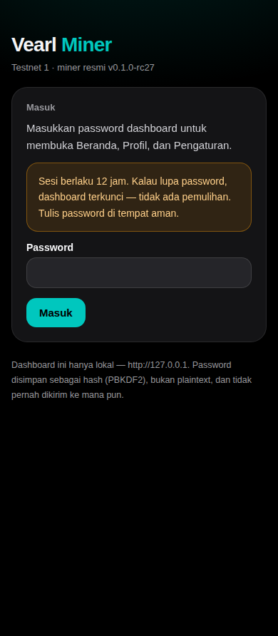
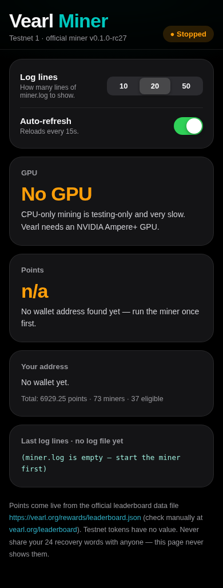
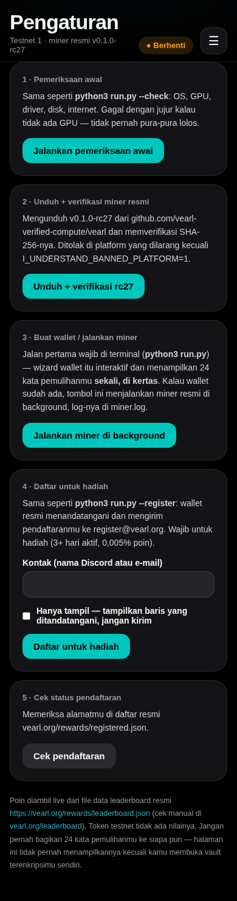

# Vearl Miner Wrapper

Wrapper Python tipis (stdlib saja) untuk **miner testnet resmi Vearl**.
Fungsinya mengunduh, memverifikasi SHA-256, menjalankan, dan memantau binary resmi — tidak lebih dari itu.

## Ini apa / bukan apa

- ✅ Ini adalah pembantu: pemeriksaan awal (preflight), unduhan terverifikasi, auto-restart, dashboard lokal.
- ❌ Ini BUKAN miner. Semua mining / Proof-of-Useful-Work dilakukan oleh binary
  resmi `vearl-miner` dari `github.com/vearl-verified-compute/vearl`.
- ❌ Ini TIDAK men-scrape Pearl, TIDAK mengimplementasikan ulang mining, dan TIDAK
  mining atas nama kamu di mana pun. Vearl bukan Pearl dan Pearl tidak pernah mendukungnya.
- Token testnet **tidak ada nilainya** dan tidak bisa dijual atau ditukar.

## Syarat

- GPU NVIDIA, generasi Ampere atau lebih baru (RTX 30/40/50, A/L/H100, compute 8.0+),
  driver Linux 575+ / Windows 580+, glibc 2.35+ (Ubuntu 22.04+).
- Tanpa GPU, miner jalan di CPU **sangat lambat** — hanya untuk testing. Hampir
  mustahil mencapai 0.005% dari total poin yang dibutuhkan untuk memenuhi syarat.

## Mulai cepat — laptop (Linux / Windows / Termux)

```bash
python3 run.py --check      # preflight: GPU, driver, disk, internet
python3 run.py --download   # fetch rc27 + verify SHA-256 + extract to ./vearl/
python3 run.py              # run the miner (auto-restart, logs to miner.log)
```

Jalan pertama membuat wallet kamu dan menampilkan **24 kata pemulihan SEKALI** — tulis
di kertas. Jangan pernah memfotonya, jangan pernah mengetiknya di mana pun, jangan pernah
memberikannya ke siapa pun. Script ini tidak pernah mencetak atau mencatatnya; hanya alamat
publik `vrl1...` kamu yang pernah ditampilkan.

Headless / VPS dengan alamat yang sudah ada (melewati wizard wallet, mode pool):

```bash
python3 run.py --address vrl1xxxxxxxxxxxxxxxxxxxx
```

Di terminal lain:

```bash
python3 run.py --dashboard  # http://127.0.0.1:8080 — status, GPU, log, live points
```

Dashboard-nya gaya iOS: dark graphite, kartu frosted-glass, sudut membulat besar,
mobile-first. Ada segmented control untuk jumlah baris log (10 / 20 / 50)
dan toggle switch untuk auto-refresh (setiap 15 dtk). Tidak ada warna ungu sama sekali —
paletnya graphite + mint/teal/amber.

## Dashboard v2 — Beranda / Profil / Pengaturan

`python3 run.py --dashboard` menyajikan halaman khusus lokal di
`http://127.0.0.1:8080` (tidak pernah `0.0.0.0`). Ketuk menu burger **☰**
(kanan atas) untuk pindah halaman — `?page=home|profile|setup`, di-render server,
tanpa framework JS, hanya script inline kecil untuk menu dan tombol salin.

- **Beranda** — halaman status aslinya: status miner, GPU, poin live dari
  leaderboard resmi, alamat kamu, baris log (10 / 20 / 50), dan toggle
  auto-refresh (15 dtk).
- **Pengaturan** — aksi-aksi terminal dalam bentuk kartu + tombol, tanpa perlu terminal:
  1) pemeriksaan awal, 2) unduh + verifikasi SHA-256 miner resmi,
  3) buat wallet / jalankan miner di background, 4) daftar untuk hadiah
  (kontak + opsi print-only), 5) cek status pendaftaran. Setiap
  aksi menampilkan output asli dan exit code-nya di halaman. Gate platform
  yang dilarang tetap berlaku: tidak ada mining/unduhan di Railway/Render/Colab/Kaggle
  kecuali `I_UNDERSTAND_BANNED_PLATFORM=1`.
- **Profil / Akun** — alamat publik `vrl1...` (tombol salin), poin /
  peringkat / hari aktif / memenuhi syarat, status pendaftaran, keberadaan file wallet.

UI dashboard web berbahasa **Indonesia** (Beranda / Profil / Akun /
Pengaturan); output CLI terminal tetap berbahasa Inggris, dan nilai `?page=`
tetap `home` / `profile` / `setup`.

### Password dashboard — wajib masuk dulu

Setiap halaman dashboard (`/?page=home|profile|setup`, `/api.json`, dan semua
endpoint `/action/*`) wajib pakai password. Tidak ada akses anonim,
bahkan di localhost.

- **Jalan pertama:** dashboard menampilkan halaman **Buat Password** (password +
  konfirmasi, min. 8 karakter). Password disimpan HANYA sebagai hash bersalt
  di `.dashboard-auth.json` (mode `0600`, git-ignored) — PBKDF2-HMAC-SHA256,
  200.000 iterasi — plus secret server acak untuk menandatangani cookie
  sesi. **Password plaintext tidak pernah disimpan di mana pun, tidak pernah dicatat.**
- **Kunjungan berikutnya:** halaman **Masuk** meminta password. Login yang benar
  mengeluarkan cookie sesi (token acak 32-byte, ditandatangani HMAC dengan
  secret server, HttpOnly, SameSite=Lax, 12 jam). Password yang salah mendapat
  pesan generik "Password salah" dan jeda 0,5 dtk. **Keluar** di menu burger
  akan logout dan menghapus cookie.
- **⚠️ Lupa password = terkunci selamanya.** Tidak ada pemulihan password
  dan tidak ada fitur ganti password. Dashboard tetap terkunci dan vault
  seed tidak bisa dibuka lagi. Tulis password di tempat yang aman,
  seperti 24 kata itu sendiri.





Screenshot di atas adalah dashboard asli yang di-render dari server live
(`python3 run.py --dashboard`), diambil di mesin tes tanpa GPU —
jadi jujur menampilkan `Stopped` / `No GPU` / `n/a` poin sampai miner
dijalankan di mesin GPU dengan wallet.



### 24 kata — TIDAK disimpan secara default

Secara default dashboard **tidak** menyimpan kata-kata pemulihan kamu di mana pun.
Kata-kata itu hanya ditampilkan sekali, saat wallet dibuat — tulis di kertas.
Halaman Profil mengatakan ini dengan jelas.

Hanya jika kamu mau (opt-in): kamu boleh menempel 24 kata sekali di halaman Profil.
Kata-kata itu disimpan di `seed.vault` (mode `0600`, git-ignored), terenkripsi dengan kunci
yang diturunkan dari **password login dashboard kamu** (PBKDF2-HMAC-SHA256, 200.000
iterasi + stream cipher mode counter SHA-256 + HMAC tag, stdlib saja).
Tidak ada lagi passphrase vault terpisah. Setelah login, halaman Profil
menampilkan kata-kata itu dengan tombol kecil **Salin**. Kata-kata itu
tidak pernah dicatat di log, tidak pernah ada di `/api.json`. **Peringatan: siapa pun yang punya akses dashboard
*dan* password kamu bisa mencuri wallet — kertas tetap cadangan paling
aman, dan lupa password mengunci vault selamanya.** Hapus vault dari
halaman Profil (wajib login).

## Deploy

| Platform | Cara | Status |
|---|---|---|
| Laptop / PC lokal (GPU sendiri) | `python3 run.py` | ✅ Direkomendasikan |
| GPU VPS — Docker | `docker compose up -d --build` | ✅ Direkomendasikan |
| GPU VPS — systemd | `vearl-miner.service` | ✅ Direkomendasikan |
| Railway | [Deploy on Railway](https://railway.app/new) dengan `deploy/railway.toml` | ❌ Dilarang — tidak direkomendasikan |
| Render | [Render Blueprint](https://dashboard.render.com/new) dengan `deploy/render.yaml` | ❌ Dilarang — tidak direkomendasikan |
| Google Colab | Buka `deploy/colab.ipynb` di Colab | ❌ Dilarang — tidak direkomendasikan |
| Kaggle | Buka `deploy/kaggle.ipynb` di Kaggle | ❌ Dilarang — tidak direkomendasikan |

Template ❌ ada hanya supaya repo menampilkan semua opsi (showcase). Di dalam
file-nya ada peringatan besar, dan `run.py` menolak mining di platform itu
kecuali kamu mengatur `I_UNDERSTAND_BANNED_PLATFORM=1`. Detail ada di
`deploy/README.md` — mining dilarang di sana, akun bisa di-suspend atau
di-terminate, dan lagipula tidak ada GPU.

## Daftar untuk hadiah

```bash
python3 run.py --register --contact "YourDiscordName"
# --print-only shows the signed lines without sending, if e-mail is blocked
```

Wallet resmi menandatangani pendaftaran dan mengirimkannya ke `register@vearl.org`.
Cek poin kamu di <https://vearl.org/leaderboard/> — kamu butuh 3+ hari aktif
dan minimal 0.005% dari semua poin. Alokasi Testnet 1: 0.7% dari max supply,
dibagi pro-rata berdasarkan poin.

## GPU VPS (satu-satunya opsi cloud yang masuk akal)

```bash
docker compose up -d --build   # needs an NVIDIA GPU + nvidia-container-toolkit
# or: systemd
sudo cp vearl-miner.service /etc/systemd/system/
sudo systemctl enable --now vearl-miner
```

## ⚠️ Jangan deploy di sini

**Railway, Render, Google Colab dan Kaggle semuanya melarang crypto mining.** Menjalankan
ini di sana akan membuat akun/layanan di-suspend atau di-terminate — AUP Railway
menyebut cryptocurrency mining sebagai penyalahgunaan, AUP Render (item 7) secara eksplisit
melarangnya, dan Colab/Kaggle juga melarangnya. Mereka juga tidak punya GPU, jadi
tidak akan menghasilkan poin juga. Template `deploy/` untuk platform itu ada hanya
sebagai showcase semua opsi, masing-masing membawa peringatan besar, dan `run.py`
menolak mining di sana kecuali kamu mengatur `I_UNDERSTAND_BANNED_PLATFORM=1`.
Pakai GPU VPS yang kamu sewa (mis. RTX 3090 di marketplace GPU) atau GPU kamu sendiri.

## File

| File | Tujuan |
|---|---|
| `run.py` | Wrapper-nya (stdlib saja, Linux + Windows + Termux) |
| `Dockerfile`, `docker-compose.yml` | Container GPU VPS |
| `vearl-miner.service` | Unit systemd untuk VPS |
| `TESTS.md` | Apa yang sudah dites di sini, dan apa yang belum |

## Variabel env

`VEALR_VERSION` (default `0.1.0-rc27`), `VEALR_DIR` (default `./vearl`),
`DASHBOARD_PORT` (default `8080`). Tidak ada secret di dalam kode, selamanya.
